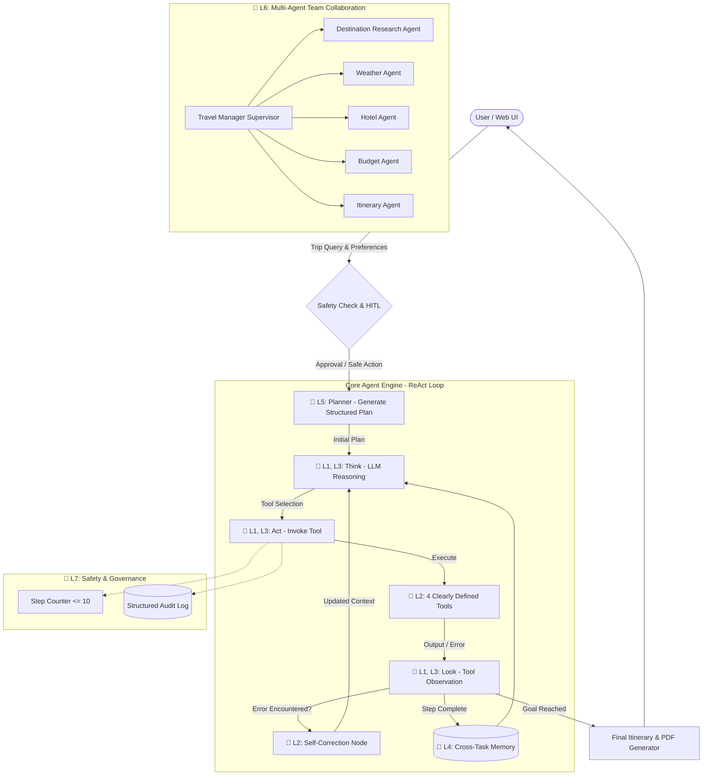

# AI Travel Planning Agent — Step-by-Step Execution Plan

**Document File:** `EXECUTION.MD` (also mirrored at `EXCUTION.MD`)  
**Based on:** `PRD.MD` (v1.0) — Bridgeon Internship Project  
**Architecture:** Multi-Agent AI System (LangGraph + FastAPI + Gemini/OpenAI + HTML/CSS/JS)  
**Curriculum Alignment:** Lessons L1 – L8 (ReAct Loop, Tools, Error Self-Correction, Memory, Planning, Safety & HITL, Testing, Multi-Agent Team)  
**Status:** Ready for Execution  

---

## Agentic AI Core Requirements Mapping (Lessons L1 – L8)

| Requirement | Lesson | Description in AI Travel Planner | Implementation Target |
| :--- | :---: | :--- | :--- |
| **1️⃣ Think → Act → Look Loop** | 📘 **L1, L3** | ReAct loop: Agent thinks (`Thought:`), selects & executes tool (`Action:`), analyzes result (`Observation:`), and repeats until final answer. | `backend/app/agents/react_loop.py` |
| **2️⃣ 2–4 Clearly Described Tools** | 📘 **L2** | 4 schema-validated tools: Destination Research, Weather Forecast, Hotel Search, and Budget Calculator. | `backend/app/services/tools.py` |
| **3️⃣ Tool Error Self-Correction** | 📘 **L2** | When a tool fails (invalid city, network error, overbudget), the error is fed to the observation, prompting the agent to self-correct. | `backend/app/agents/error_handler.py` |
| **4️⃣ Memory Between Tasks** | 📘 **L4** | Persistent memory storing user preferences (dietary, pace, preferred airlines/hotels) and trip history across multiple sessions. | `backend/app/agents/memory.py` |
| **5️⃣ Plan Before It Acts** | 📘 **L5** | Plan-and-Solve: Agent generates a structured 5-step execution plan before executing tools, tracking progress on a scratchpad. | `backend/app/agents/planner.py` |
| **6️⃣ Safety Guardrails** | 📘 **L7** | **Asks you first** (HITL confirmation before booking/expensive actions), **Step Limit** (`max_steps=10`), and **Audit Logging**. | `backend/app/agents/safety.py` |
| **7️⃣ Comprehensive Testing** | 📘 **L8** | **Fake LLM first** (deterministic mock tests verifying loop, tools, and error handling) followed by **Real LLM** (Gemini live tests). | `tests/test_agent_fake_llm.py` & `test_agent_real_llm.py` |
| **⭐ Bonus: Team of Agents** | 📘 **L6** | Multi-agent collaboration: Travel Manager (Supervisor) orchestrating Destination, Weather, Hotel, Budget, and Itinerary worker agents. | `backend/app/agents/graph.py` |

---

## Table of Contents
1. [Architecture & System Flow Overview](#1-architecture--system-flow-overview)
2. [Project Directory Structure](#2-project-directory-structure)
3. [Curriculum Module Breakdown (Part-by-Part)](#3-curriculum-module-breakdown-part-by-part)
   - [Part 1: The Core ReAct Engine & Tools (L1, L2, L3)](#part-1-the-core-react-engine--tools-l1-l2-l3)
   - [Part 2: Error Self-Correction & Robustness (L2)](#part-2-error-self-correction--robustness-l2)
   - [Part 3: Cross-Task Persistent Memory (L4)](#part-3-cross-task-persistent-memory-l4)
   - [Part 4: Upfront Planning & Scratchpad (L5)](#part-4-upfront-planning--scratchpad-l5)
   - [Part 5: Safety Guardrails & Human-in-the-Loop (L7)](#part-5-safety-guardrails--human-in-the-loop-l7)
   - [Part 6: Testing with Fake LLM & Real LLM (L8)](#part-6-testing-with-fake-llm--real-llm-l8)
   - [Part 7: Multi-Agent Team Orchestration (L6 Bonus)](#part-7-multi-agent-team-orchestration-l6-bonus)
4. [FastAPI Backend & API Endpoints](#4-fastapi-backend--api-endpoints)
5. [PDF Report Generator (ReportLab)](#5-pdf-report-generator-reportlab)
6. [Interactive Web Frontend (HTML/CSS/JS)](#6-interactive-web-frontend-htmlcssjs)
7. [Deployment, Docker & Demo Scenarios](#7-deployment-docker--demo-scenarios)
8. [Milestone Checklist & Progress Tracker](#8-milestone-checklist--progress-tracker)

---

## 1. Architecture & System Flow Overview



---

## 2. Project Directory Structure

```text
agentic-ai-travel-planner/
│
├── backend/
│   ├── app/
│   │   ├── __init__.py
│   │   ├── main.py                     # FastAPI entry point & CORS configuration
│   │   ├── config.py                   # Pydantic Settings & environment variables
│   │   │
│   │   ├── core/                       # L1-L7 Core Agent Components
│   │   │   ├── __init__.py
│   │   │   ├── react_agent.py          # 📘 L1, L3: Think-Act-Look Loop
│   │   │   ├── tools.py                # 📘 L2: 4 clearly described tools
│   │   │   ├── error_handler.py        # 📘 L2: Tool failure self-correction
│   │   │   ├── memory.py               # 📘 L4: Cross-task persistent memory
│   │   │   ├── planner.py              # 📘 L5: Upfront planning & scratchpad
│   │   │   └── safety.py               # 📘 L7: Step limit, HITL prompt, audit log
│   │   │
│   │   ├── multi_agent/                # 📘 L6: Team of Agents (Bonus)
│   │   │   ├── __init__.py
│   │   │   ├── state.py                # Graph State schema
│   │   │   ├── supervisor.py           # Travel Manager coordinator
│   │   │   ├── worker_agents.py        # Specialized subagents
│   │   │   └── team_graph.py           # LangGraph compiled team workflow
│   │   │
│   │   ├── services/                   # External API services
│   │   │   ├── __init__.py
│   │   │   ├── llm_service.py          # Gemini / OpenAI model factory + FakeLLM
│   │   │   ├── weather_service.py      # Weather client with offline fallback
│   │   │   ├── places_service.py       # Places / attractions client
│   │   │   ├── hotel_service.py        # Accommodation search client
│   │   │   └── pdf_service.py          # ReportLab PDF generator
│   │   │
│   │   ├── models/                     # Data schemas & ORM entities
│   │   │   ├── __init__.py
│   │   │   ├── schemas.py              # Pydantic request/response schemas
│   │   │   └── database.py             # SQLite / PostgreSQL persistence
│   │   │
│   │   └── api/                        # API route handlers
│   │       ├── __init__.py
│   │       ├── routes_trip.py          # /api/trip/plan, /api/trip/{id}
│   │       ├── routes_chat.py          # /api/chat conversational modifications
│   │       └── routes_pdf.py           # /api/trip/{id}/pdf download
│   │
│   ├── requirements.txt
│   ├── .env.example
│   └── Dockerfile
│
├── frontend/
│   ├── index.html                      # Primary Single Page App (SPA)
│   ├── css/
│   │   ├── styles.css                  # Responsive design, theme variables, glassmorphism
│   │   └── components.css              # Cards, timeline, chat drawer, modal styles
│   ├── js/
│   │   ├── app.js                      # Application initialization & state
│   │   ├── api.js                      # Fetch API communication layer
│   │   ├── form_handler.js             # User travel input form validation & submission
│   │   ├── agent_tracker.js            # Live visual status of multi-agent execution
│   │   ├── itinerary_view.js           # Renders daily schedule, maps, budget breakdown
│   │   └── chat_assistant.js           # Conversational plan modification drawer
│   └── assets/
│
├── tests/                              # 📘 L8: Comprehensive Testing
│   ├── __init__.py
│   ├── fake_llm.py                     # Deterministic mock LLM for testing
│   ├── test_agent_fake_llm.py          # Unit tests: Loop, tools, errors, memory, safety
│   ├── test_agent_real_llm.py          # Integration test with live Gemini API
│   ├── test_multi_agent_team.py        # Multi-agent collaboration tests
│   └── test_pdf.py                     # PDF generation and format validation
│
├── PRD.MD                              # Product Requirements Document
├── EXECUTION.MD                        # Step-by-Step Implementation Blueprint
├── EXCUTION.MD                        # Mirrored Blueprint (exact name)
└── README.md                           # Setup & Quickstart Guide
```

---

## 3. Curriculum Module Breakdown (Part-by-Part)

### Part 1: The Core ReAct Engine & Tools (📘 L1, L2, L3)
**Goal:** Implement a clean Think → Act → Look loop with 4 clearly described tools.
- **The Loop (`react_agent.py`)**:
  - `think()`: Prompts LLM with user query, history, and available tool descriptions. Formats response as:
    ```text
    Thought: I need to check the weather in Tokyo first to advise on outdoor activities.
    Action: get_weather_forecast(city="Tokyo", days=5)
    ```
  - `act()`: Parses the tool name and arguments, executes the matching Python function.
  - `look()`: Captures the tool output as `Observation:` and feeds it back into context.
- **The 4 Clearly Described Tools (`tools.py`)**:
  1. `search_destinations_and_attractions(city: str, category: str) -> List[Dict]`:
     - *Description:* Searches top tourist spots, cultural sights, and activities for a given destination.
  2. `get_weather_forecast(city: str, days: int) -> Dict`:
     - *Description:* Retrieves temperature, rain forecast, and weather conditions for the trip dates.
  3. `search_hotels(city: str, budget_tier: str, nights: int, guests: int) -> List[Dict]`:
     - *Description:* Finds accommodation options filtered by budget category (budget, mid-range, luxury).
  4. `calculate_budget_allocation(total_budget: float, stay_cost: float, days: int) -> Dict`:
     - *Description:* Computes daily allowance, food, transport, and emergency buffer from total funds.

### Part 2: Error Self-Correction & Robustness (📘 L2)
**Goal:** Prevent crashes when a tool fails; enable the agent to diagnose and self-correct.
- **Error Interceptor (`error_handler.py`)**:
  - Wraps all tool invocations with `try/except`.
  - Captures `CityNotFoundError`, `BudgetExceededError`, `TimeoutError`, or invalid argument types.
- **Observation Feedback for Self-Correction**:
  - Instead of throwing an unhandled exception, return an informative observation:
    ```text
    Observation: ToolError: Destination 'Tokyoo' not found. Did you mean 'Tokyo'?
    Thought: I made a typo in the destination name. I will call search_destinations_and_attractions with 'Tokyo'.
    Action: search_destinations_and_attractions(city="Tokyo", category="culture")
    ```
  - The loop automatically continues and corrects the mistake.

### Part 3: Cross-Task Persistent Memory (📘 L4)
**Goal:** Maintain user preferences and knowledge across independent planning sessions.
- **Memory Store (`memory.py`)**:
  - Persistent storage using SQLite / JSON.
  - Stores:
    - User travel profile: dietary restrictions (e.g. Vegetarian), travel pace (Fast-paced vs. Relaxed), favorite hotel styles.
    - Previous trips: past visited destinations, booked hotels, total spent.
- **Memory Retrieval & Injection**:
  - At the start of any new query, relevant memories are recalled:
    ```text
    User: "Plan a 3-day weekend trip to Paris."
    Memory Injected: [User prefers walking tours, vegetarian food, and boutique hotels under $150/night]
    Thought: Since the user is vegetarian and prefers boutique hotels, I will filter hotels and restaurants accordingly.
    ```

### Part 4: Upfront Planning & Scratchpad (📘 L5)
**Goal:** Prevent haphazard tool calling by forcing the agent to formulate an explicit plan before acting.
- **Planner Module (`planner.py`)**:
  - Before taking the first action, the agent calls the planner to generate an ordered checklist:
    ```text
    Plan:
    1. [ ] Recall user preferences from memory
    2. [ ] Fetch 5-day weather forecast for destination
    3. [ ] Research top sights matching user preferences
    4. [ ] Find hotels within budget
    5. [ ] Calculate cost breakdown and emergency buffer
    6. [ ] Synthesize final day-by-day itinerary
    ```
  - As each step completes, the agent updates the scratchpad (`[x] Step 1`, `[x] Step 2`) so it always knows its current progress.

### Part 5: Safety Guardrails & Human-in-the-Loop (📘 L7)
**Goal:** Enforce safety, prevent runaway loops, and require human approval for critical actions.
- **Safety Engine (`safety.py`)**:
  1. **Step Limit**: Hard cap of `max_steps = 10`. If the agent exceeds 10 iterations without reaching a conclusion, the loop terminates safely with a partial plan and diagnostic warning.
  2. **Asks You First (Human-in-the-Loop)**:
     - For high-consequence actions (e.g. `confirm_hotel_reservation` or when estimated cost exceeds user budget by >15%), execution pauses.
     - Yields a confirmation request: `[CONFIRMATION_REQUIRED: Book Hotel Grand ($420)? (yes/no)]`.
     - Waits for user input before proceeding.
  3. **Structured Audit Log**:
     - Writes every `Thought`, `Action`, `Observation`, and `SafetyGate` to `logs/agent_audit.log` with microsecond timestamps and token usage.

### Part 6: Testing with Fake LLM & Real LLM (📘 L8)
**Goal:** Verify reliability deterministically before spending money on live API calls.
- **Fake LLM Test Harness (`tests/fake_llm.py` & `tests/test_agent_fake_llm.py`)**:
  - Deterministic scripted LLM responses.
  - Tests:
    - Test 1: Full Think → Act → Look loop completes in expected steps.
    - Test 2: Tool failure properly triggers self-correction without crashing.
    - Test 3: Upfront plan is generated and scratchpad updates.
    - Test 4: Memory persists across two sequential tasks.
    - Test 5: Step limit halts execution when step count exceeds 10.
    - Test 6: Human confirmation trigger blocks execution until confirmed.
- **Real LLM Integration Test (`tests/test_agent_real_llm.py`)**:
  - Live Gemini 1.5 Flash test for an end-to-end itinerary generation.

### Part 7: Multi-Agent Team Orchestration (📘 L6 Bonus)
**Goal:** Coordinate a specialized team of agents for scalable, high-quality travel planning.
- **Supervisor (Travel Manager)**:
  - Decomposes the user prompt into subtasks.
  - Delegates to specialized workers:
    - 🏛️ **Destination Research Agent**
    - ☀️ **Weather Information Agent**
    - 🏨 **Hotel Recommendation Agent**
    - 💰 **Budget Planning Agent**
    - 🗺️ **Itinerary Scheduling Agent**
  - Aggregates their outputs into a cohesive final itinerary.

---

## 4. FastAPI Backend & API Endpoints

- `POST /api/trip/plan`: Accepts `TripRequest`, runs the agent pipeline, returns `TripPlanResponse`.
- `POST /api/trip/plan/stream`: Streams live agent thoughts, actions, and observations using Server-Sent Events (SSE).
- `POST /api/chat`: Conversational modification (e.g., *"Make Day 2 more kid-friendly"*).
- `GET /api/trip/{id}/pdf`: Generates and streams PDF report.
- `GET /api/health`: Health status of LLM, memory DB, and tools.

---

## 5. PDF Report Generator (ReportLab)

- Automated generation of a professional, styled multi-page PDF:
  - Header & Trip Summary
  - Day-by-Day schedule with morning, afternoon, and evening slots
  - Weather overview table & advisory notes
  - Hotel comparison cards
  - Itemized budget table with buffer breakdown
  - Packing and safety checklist

---

## 6. Interactive Web Frontend (HTML/CSS/JS)

- Modern Single Page App (SPA):
  - **Travel Input Form**: Destination, dates, budget slider, travel style tags.
  - **Live Agent Tracker**: Real-time visualization of the ReAct loop and subagents.
  - **Itinerary View**: Interactive timeline, hotel cards, and budget charts.
  - **AI Chat Drawer**: Slide-out conversational panel for real-time adjustments.
  - **PDF Export**: One-click download button.

---

## 7. Deployment, Docker & Demo Scenarios

- **Docker Containerization**:
  - Multi-stage `Dockerfile` (Python 3.11 backend + static frontend).
  - `docker-compose.yml` for unified local execution.
- **Demo Scenarios for Project Review**:
  1. *Solo Backpacker in Tokyo (Budget focus & error recovery demo)*
  2. *Family Vacation in Switzerland (Multi-agent & weather adaptation)*
  3. *Weekend Cultural Getaway in Jaipur (Memory between tasks demo)*

---

## 8. Milestone Checklist & Progress Tracker

| Milestone | Curriculum Focus | Deliverables | Status |
| :---: | :--- | :--- | :---: |
| **M0** | Phase 0: Pre-flight & Setup | `execute_phase0.py`, `backend/.env`, `app/config.py` | [x] Completed |
| **M1** | Environment & Setup | Project structure, `requirements.txt`, `.env.example` | [x] Completed |
| **M2** | 📘 **L1, L2, L3**: Core ReAct & Tools | `tools.py` (4 tools), `react_agent.py` (Think-Act-Look), `execute_phase1.py` | [x] Completed |
| **M3** | 📘 **L2**: Error Self-Correction | `error_handler.py` with feedback loop & test | [x] Completed |
| **M4** | 📘 **L4**: Persistent Memory | `memory.py`, `database.py`, `execute_phase2.py` | [x] Completed |
| **M5** | 📘 **L5**: Upfront Planning | `planner.py` with scratchpad checklist, `execute_phase4.py` | [x] Completed |
| **M6** | 📘 **L7**: Safety & Guardrails | `safety.py` (HITL prompt, step limit = 10, audit log), `execute_phase5.py` | [x] Completed |
| **M7** | 📘 **L8**: Fake & Real LLM Tests | `test_agent_fake_llm.py` & `test_agent_real_llm.py` (18 passing tests) | [x] Completed |
| **M8** | 📘 **L6**: Multi-Agent Team (Bonus) | LangGraph / Supervisor + 5 worker agents in `multi_agent/` | [x] Completed |
| **M9** | Backend API & PDF Service | FastAPI REST endpoints & ReportLab PDF generator (`test_api.py`, `test_pdf.py`) | [x] Completed |
| **M10** | Frontend UI & Demo | Responsive web UI (`index.html`, `styles.css`, `app.js`, `run_server.py`) | [x] Completed |

---

*This blueprint adheres strictly to the curriculum requirements (Lessons L1 through L8) and guides the incremental development of the AI Travel Planning Agent.*
